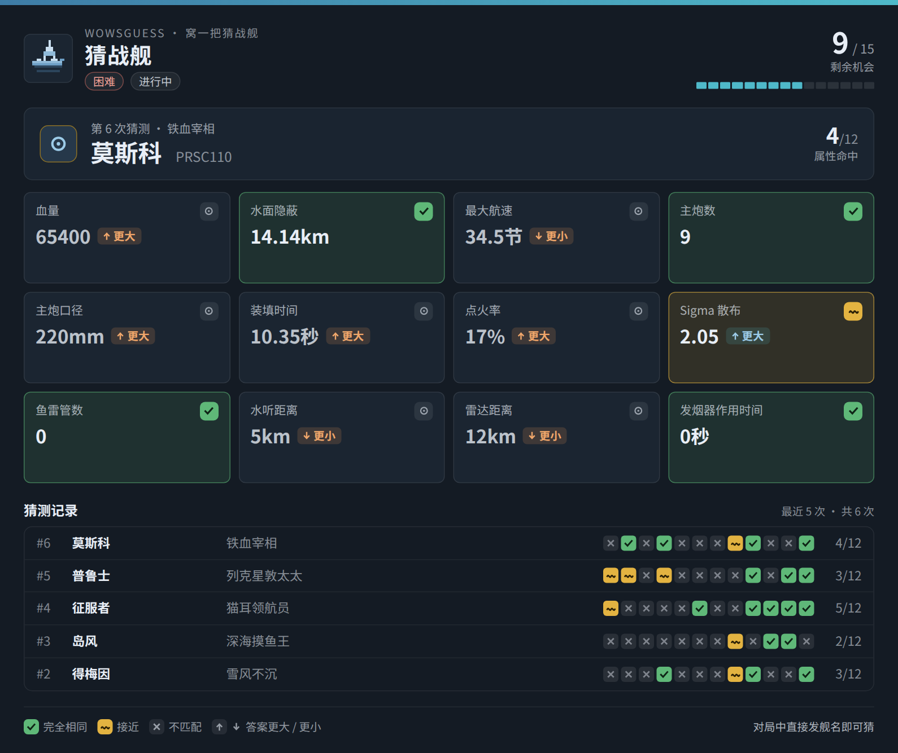
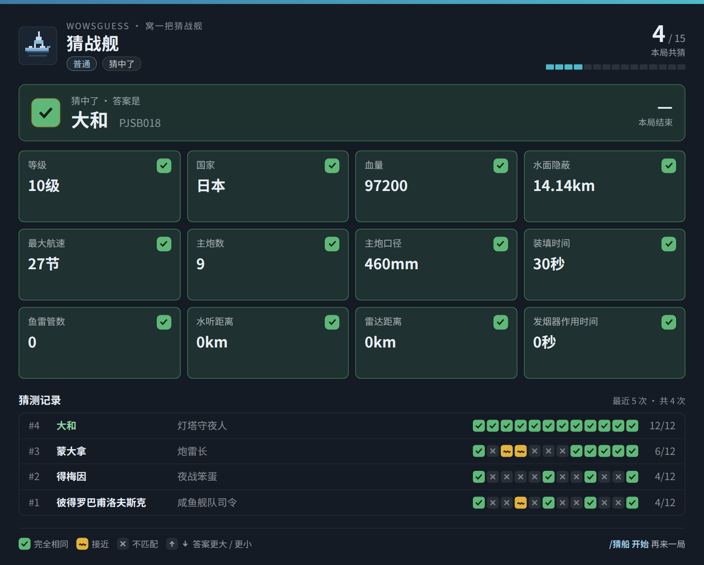
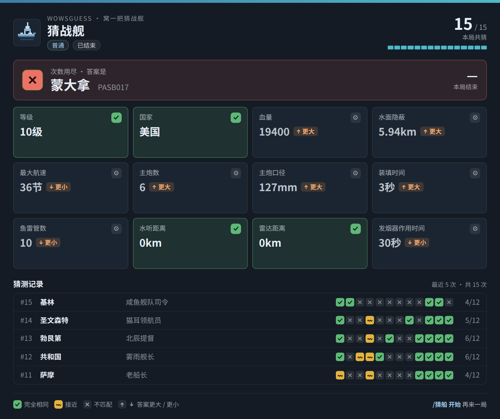
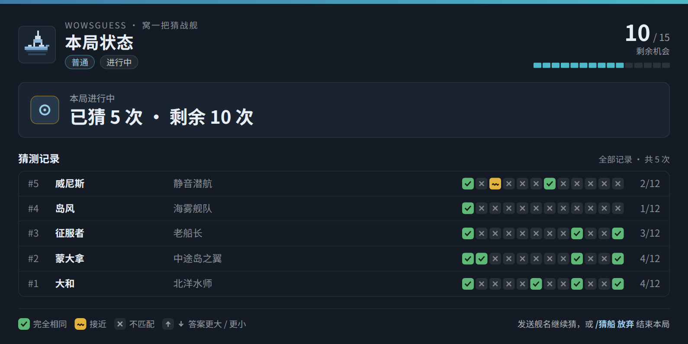
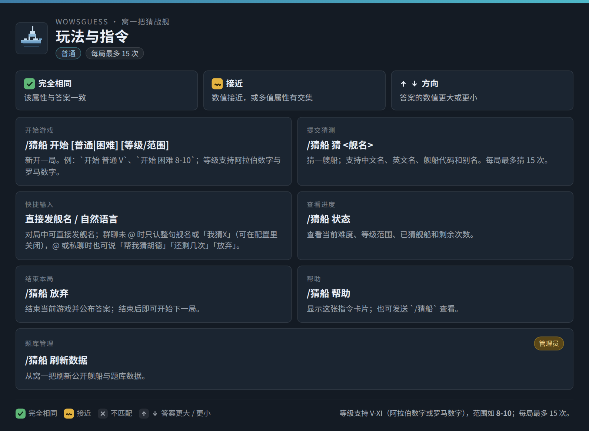

# WowsGuess AstrBot 插件

将 [woyiba.com](https://www.woyiba.com/) 的《战舰世界》猜船玩法搬进 AstrBot 聊天：发送舰名猜答案，插件按舰种、等级、血量、火力等 12 项属性给出 🟩 精确 / 🟨 接近 / ⬆⬇ 方向 / ⬜ 不匹配的反馈，直到猜中或 15 次用尽。

## 指令

| 指令 | 说明 |
| --- | --- |
| `/猜船 开始 [普通\|困难] [等级/范围]` | 新开一局（默认普通）；可限制答案等级，如 `V`、`8-10`、`VIII-X`。 |
| `/猜船 猜 <舰名>` | 提交猜测，支持中文名、英文名、代码或别名。 |
| `/猜船 状态` | 查看进度与已猜记录（卡片）。 |
| `/猜船 放弃` | 结束本局并公布答案（卡片）。 |
| `/猜船 帮助` | 查看玩法与判定规则（卡片）。 |
| `/猜船 刷新数据` | 下载最新公开题库，仅管理员可用。 |

- 对局中不必输入 `/猜船 猜`：直接发舰名即算一次猜测（见“自然语言与免命令”）。
- 每局最多 15 次；群聊内的命令与自然语言需要 @机器人（免 @ 直猜除外）。

## 卡片与渲染

猜测、状态、放弃、帮助都会渲染为 1060px 深色卡片：12 格属性反馈 + 最近 5 次记录（状态卡 10 次），属性格 4 列三行；猜中、放弃或次数用尽后直接展示答案。

- 默认 `render_backend=auto`：本地 Playwright + Chromium 截图优先（热态约 0.3s），失败自动回退 AstrBot 远端 `html_render()`，仍失败则熔断并回退纯文本。
- 本地/远端分别有超时（默认 20s / 15s）；未安装 Playwright 的机器自动保持远端渲染；`render_cards=false` 强制纯文本。
- 图片格式、清晰度倍率、浏览器路径、超时与回退策略均可配置。

### 卡片预览

| 猜测卡 | 猜中卡 | 次数用尽结算卡 |
| --- | --- | --- |
|  |  |  |

| 状态卡 | 帮助卡 |
| --- | --- |
|  |  | 

预览图中的对局与玩家名为演示数据；词库、答案与属性比较逻辑均为真实实现。

## 自然语言与免命令

- **免命令直猜**（`free_text_guess`，默认开启）：对局中直接发“整句舰名”即算一次；@机器人时还接受“猜/我猜/帮我猜”前缀与“号/舰”后缀及标点；长句不误判，匹配不上则照常交给 LLM 聊天。
- **群聊免 @**（`group_guess_without_at`，默认开启）：对局中整句是舰名或“我猜X”才计为猜测，闲聊不接管；`状态/放弃`等指令仍需 @；重复舰名静默忽略；命中后 `stop_event`，避免其他插件重复回复。
- **LLM 工具**（`llm_tool_enabled`，默认开启）：注册 `wows_guess` 工具，支持“帮我猜胡德”“还剩几次”“放弃”“开始困难 8-10 级”等自然语言（需模型支持 function calling）。仅在消息与猜船相关或刚用过工具时暴露工具；对局提示以临时内容片段注入，不破坏系统提示词缓存。
- **只发卡片**（`llm_tool_cards_only`，默认开启）：工具发送卡片后直接结束本轮，不再让模型补充文字。

## 配置

| 配置 | 默认 | 说明 |
| --- | --- | --- |
| `refresh_on_start` | `true` | 启动时刷新题库；有缓存则后台刷新、不阻塞加载，失败继续用旧缓存。 |
| `free_text_guess` | `true` | 对局中直接发舰名即算一次猜测。 |
| `group_guess_without_at` | `true` | 群聊未 @ 时也允许猜船（整句舰名/“我猜X”）。 |
| `render_cards` | `true` | 用图片卡片展示反馈与帮助；关闭后改为纯文本。 |
| `render_backend` | `auto` | `auto` 本地优先、失败回退远端；`local` 只用本地；`remote` 只用远端 `html_render`。 |
| `card_image_format` | `png` | `png` 最清晰；`jpeg` 体积更小。 |
| `card_image_quality` | `80` | 30–95，仅 `jpeg` 生效。 |
| `render_scale` | `1.5` | 0.5–2.0；1.5 约输出 1590px 宽。 |
| `browser_path` | 空 | 留空自动探测 Playwright 浏览器，异常时可手动指定。 |
| `local_render_timeout_seconds` | `20` | 本地渲染超时（含首次 Chromium 冷启动）。 |
| `remote_render_fallback` | `true` | `auto` 模式下本地失败是否回退远端。 |
| `render_timeout_seconds` | `15` | 远端渲染超时，超时改发纯文本。 |
| `llm_tool_enabled` | `true` | 注册 `wows_guess` LLM 工具。 |
| `llm_tool_cards_only` | `true` | 发卡后结束本轮，不再请求模型补文字。 |

短标题与说明与插件配置页一致（`_conf_schema.json`）；每局 15 次为 `main.py` 常量，暂未开放配置。

## 数据与联网

- 首次使用从 `https://www.woyiba.com/data/` 下载 5 个公开 JSON，缓存到 `data/plugin_data/astrbot_plugin_wowsguess/woyiba_data/`：单文件 8 MB、总计 24 MB 上限，10s 超时、30s 总预算，仅接受 `https://www.woyiba.com`，逐字段校验后原子替换。
- 启动时后台刷新不阻塞插件加载；`/猜船 刷新数据` 同步刷新并提示结果，失败继续使用本地缓存；首次加载且断网时 `/猜船 开始` 会提示明确错误。
- 仅使用公开静态舰船资料，不调用每日挑战/个人统计/多人房间接口，不共享用户信息。

## 安装、兼容与测试

将本目录放入 AstrBot 的 `data/plugins/astrbot_plugin_wowsguess/`，在 WebUI 重载插件；AstrBot 会按 `requirements.txt` 安装 `aiohttp` 与 `playwright`。本地渲染需再安装 Chromium：

```bash
cd /path/to/AstrBot
./.venv/bin/python -m playwright install chromium
```

- 未安装 Playwright/Chromium 也能用，插件会自动回退远端 `html_render()`。
- 兼容 AstrBot `>=4.16,<5`；插件数据目录通过 `StarTools.get_data_dir()` 获取。
- 单元测试：`python -m pytest astrbot_plugin_wowsguess/tests`（需已安装 AstrBot，建议在插件目录的上一级运行），覆盖自由文本匹配、LLM 工具校验与按需暴露、本地渲染器及超时/熔断/回退。

## 来源与声明

玩法、公开数据结构与判定规则基于 woyiba.com 已公开前端资源的静态分析，原站：<https://www.woyiba.com/>。本插件为独立 Python 实现，不复制或分发原站 JavaScript、样式、图片或服务端代码；未移植多人房间、每日排行榜与账号统计系统。
